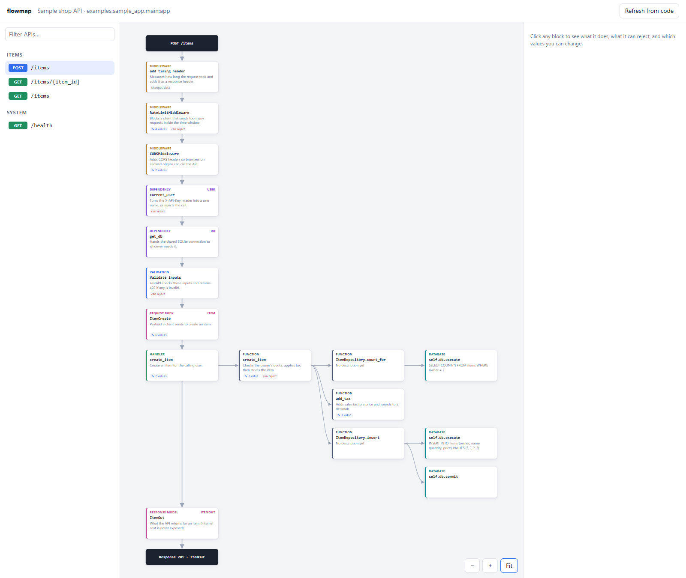

# polestar-vega

Pictorial representation of a FastAPI project.

The library is **flowmap**: an interactive flow diagram for every endpoint (middleware, dependencies,
validation, handler, service calls, database) where you can change a value in the picture and have it
written back into the code.



```bash
cd flowmap-lib
pip install -e .
flowmap serve examples.sample_app.main:app
```

Or add one line to your own app and open `/flowmap`, next to Swagger's `/docs`:

```python
from flowmap import mount_flowmap
mount_flowmap(app)
```

➡️ **[Full documentation](flowmap-lib/README.md)** · [Requirements and roadmap](REQUIREMENTS.md)
