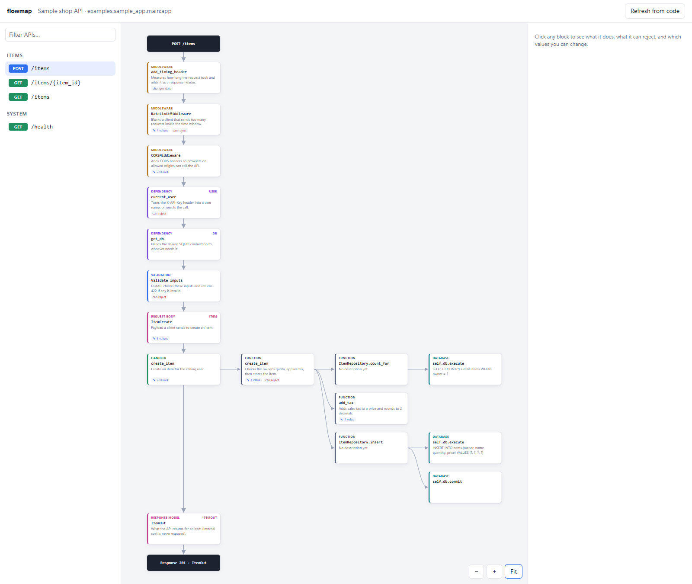
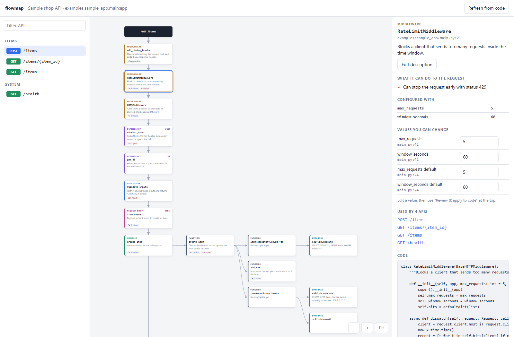
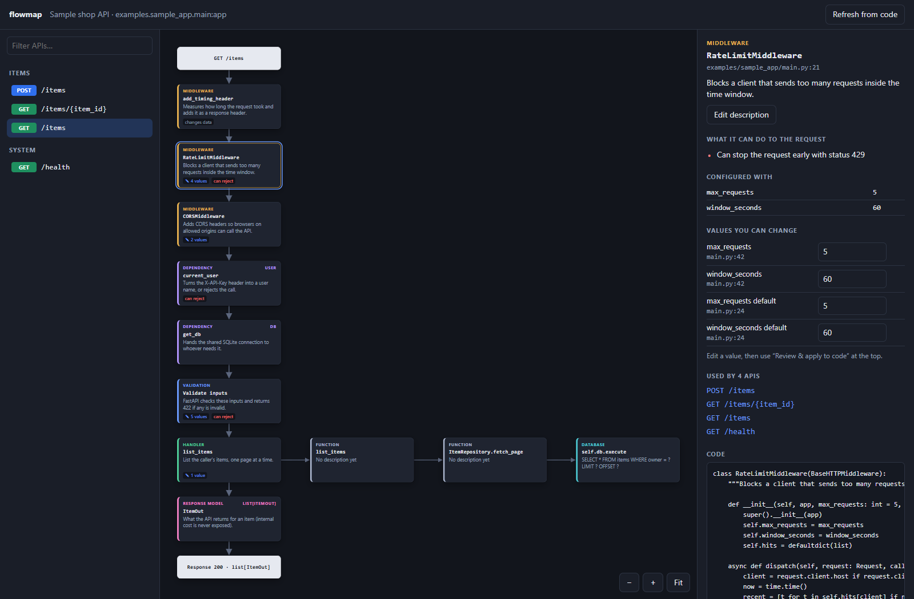
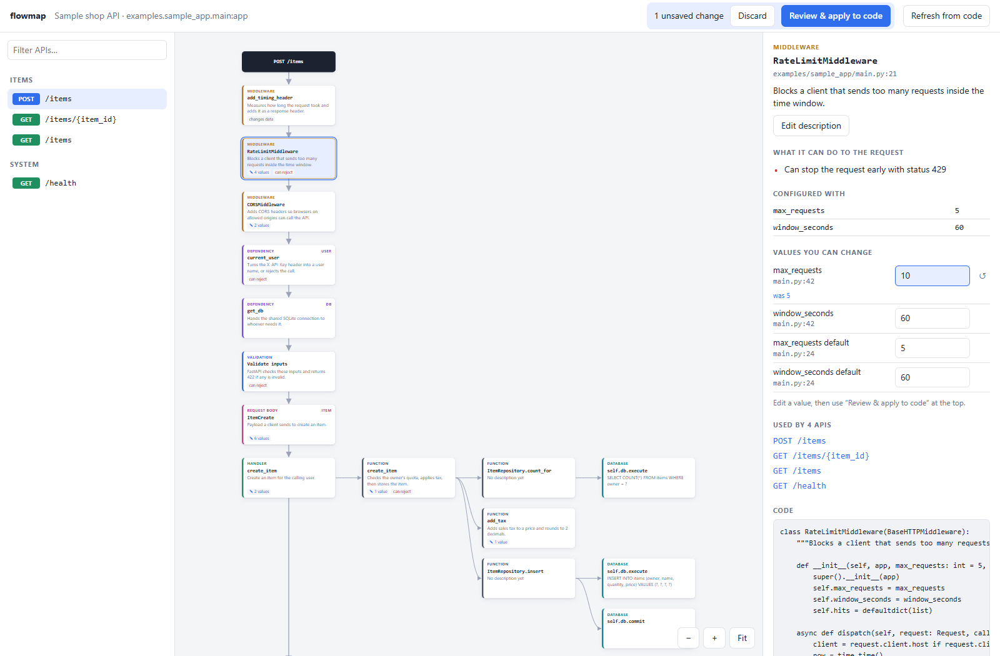
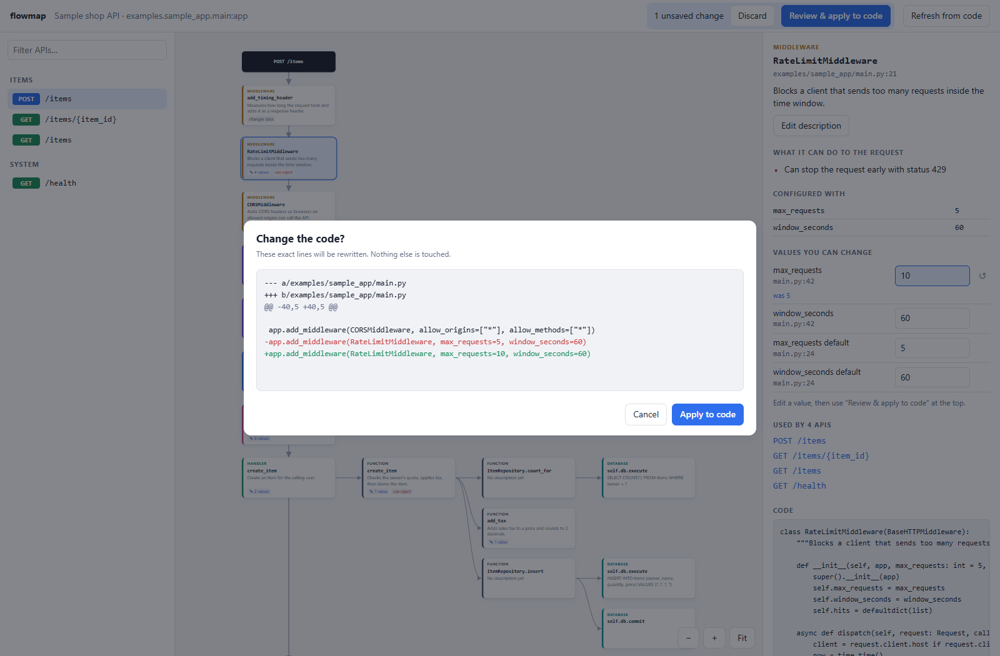

<div align="center">

# 🗺️ flowmap

### See how every FastAPI endpoint really works — and change it from the picture.

Add one line to your app (or run one command) and get an interactive map of each API:
middleware → dependencies → validation → handler → service functions → database.
Change a limit in the diagram, review the diff, and the code is updated for you.

[](https://pypi.org/project/polestar-vega/)
[](https://pypi.org/project/polestar-vega/)
[](https://pypi.org/project/polestar-vega/)
[](https://github.com/ashokpkumar/polestar-vega/actions/workflows/tests.yml)
[](https://github.com/ashokpkumar/polestar-vega/blob/main/LICENSE)




</div>

---

## Contents

- [Why flowmap](#why-flowmap)
- [Quick start](#quick-start)
- [Two ways to run it](#two-ways-to-run-it)
- [Tour of the UI](#tour-of-the-ui)
- [Change code from the diagram](#change-code-from-the-diagram)
- [What each block means](#what-each-block-means)
- [The spec file](#the-spec-file)
- [AI descriptions (optional)](#ai-descriptions-optional)
- [Command reference](#command-reference)
- [Mount options](#mount-options)
- [Security](#security)
- [How it works](#how-it-works)
- [Limits of this prototype](#limits-of-this-prototype)
- [Development](#development)

---

## Why flowmap

Swagger tells you **what** an API accepts. It doesn't tell you **what happens in between**:
the middleware that rate-limits a call, the dependency that rejects a bad key, the service
function that checks a quota, the SQL that finally runs. To learn that you read code.
To change it (say, raise a limit from 5 to 10) you hunt for the right line.

flowmap reads your existing app, **without any change to it**, and:

| | |
|---|---|
| 🧭 **Draws** | every endpoint as a top-to-bottom flow, in the order a request really travels |
| 📖 **Explains** | each block in plain language: what it can reject, which headers it reads or sets |
| 🗃️ **Records** | the whole app in one diff-friendly file, `flowmap.json`, that you can commit |
| ✏️ **Edits** | change a value in the picture; flowmap shows a diff and writes the exact line back |

Inspired by [fastapi-voyager](https://github.com/allmonday/fastapi-voyager), but it goes past routes
and models to cover middleware, dependencies, call trees and data sinks.

---

## Quick start

```bash
pip install polestar-vega   # needs Python 3.9+ and FastAPI
```

The package on PyPI is called **polestar-vega**. In code and on the command line it is still **flowmap**
(`from flowmap import mount_flowmap`, `flowmap serve ...`).

From a clone of the repo instead: `pip install -e .` inside `flowmap-lib/`.

Try it on the bundled sample shop API:

```bash
flowmap serve examples.sample_app.main:app
```

Your browser opens at **http://127.0.0.1:8765**. Click an API on the left, click any block.

On your own project, run it from the project folder with your app as `module:attribute`:

```bash
flowmap serve main:app
```

---

## Two ways to run it

### 1. As a separate app

```bash
flowmap serve main:app                # http://127.0.0.1:8765
flowmap serve main:app --port 9000 --no-open
```

Nothing to change in your code. Good for exploring, onboarding, and quick edits.
Editing is **on**, and the server only listens on `127.0.0.1`.

### 2. Inside your own FastAPI app, like Swagger's `/docs`

```python
from fastapi import FastAPI
from flowmap import mount_flowmap

app = FastAPI()

# ... your routes and middleware ...

mount_flowmap(app)                    # diagram at /flowmap
```

```bash
uvicorn main:app --reload
# Swagger  →  http://localhost:8000/docs
# flowmap  →  http://localhost:8000/flowmap
```

| | `flowmap serve` | `mount_flowmap(app)` |
|---|---|---|
| Code changes needed | none | one line |
| Address | `127.0.0.1:8765` | your app, at `/flowmap` |
| Editing code from the page | on | **off** unless `allow_edit=True` |
| Appears in its own diagram | n/a | no, its routes are hidden from the schema |

> Mounted editing is off by default because your app may be reachable from other machines,
> and editing writes to your source files. Use `mount_flowmap(app, allow_edit=True)` for local
> development only. See [Security](#security).

---

## Tour of the UI

### Click any block to understand it



The right-hand panel shows, for the block you picked:

- a one-line **description** (from the docstring, a hand-written note, or AI),
- **what it can do to the request**: reject with a status, return early, set or read headers,
- its **inputs**, **fields** or **configuration**,
- the **values you can change**,
- **which other APIs use it** (click to jump there),
- its **source code**, with file and line.

### Light and dark, automatically



The page follows your system theme. You can pan, zoom, and press **Fit** to frame the diagram.
The list on the left is grouped by tag and has a search box.

### Block colours

| Colour | Block | Meaning |
|---|---|---|
| 🟧 amber | **Middleware** | runs before your route, outermost first |
| 🟪 purple | **Dependency** | a `Depends(...)` call, including nested ones |
| 🟥 red | **Security** | an auth scheme such as an API key or OAuth2 |
| 🟦 blue | **Validation** | path, query, header, cookie and body rules |
| 🌸 pink | **Request body / Response model** | Pydantic models and their field rules |
| 🟩 green | **Handler** | your endpoint function |
| ⬜ grey | **Function** | a project function the handler calls |
| 🟦 teal | **Data** | database, HTTP, cache or file calls, with the SQL text when it is literal |

---

## Change code from the diagram

1. **Click a block**, then change a number under *Values you can change*.
   A bar appears at the top: *"1 unsaved change"*.

   

2. Press **Review & apply to code**. You see exactly what will be rewritten, and nothing else is touched:

   

3. Press **Apply to code**. The literal is rewritten in the source file and the diagram is rebuilt from the code.

**These edits don't use AI.** flowmap knows the exact position of every literal, so the rewrite is
precise and repeatable, and formatting and comments are kept. A change is **refused** if the file was
edited since the diagram was built, or if the new value is the wrong type (text for a number).

### What you can edit

| Kind | Example |
|---|---|
| Pydantic `Field(...)` rules and defaults | `quantity: int = Field(default=1, ge=0, le=5)` |
| `Query(...)`, `Path(...)`, `Header(...)` rules | `limit: int = Query(10, ge=1, le=50)` |
| Plain parameter defaults | `page_size: int = 20` |
| `add_middleware(...)` arguments | `max_requests=5` → `10` |
| Decorator arguments | `status_code=201`, route path, rate-limit strings |
| Module-level constants a function uses | `MAX_ITEMS = 20` |
| Numbers in comparisons | `if len(rows) > 100` |

### No browser? Edit the spec file

Change a `value` in `flowmap.json`, then:

```bash
flowmap apply main:app --dry-run     # show the diff only
flowmap apply main:app               # write it into the code
```

---

## What each block means

flowmap lists what a block *can* do by reading its code, so you don't have to:

| You will see | Found from |
|---|---|
| "Can stop the request early with status 429" | an early `return JSONResponse(..., status_code=429)` |
| "Can reject with 401: Invalid API key" | `raise HTTPException(401, ...)` |
| "Sets response header X-Process-Time" | `response.headers[...] = ...` |
| "Reads header X-API-Key" | `Header(...)` or `request.headers[...]` |
| `SELECT ... FROM items WHERE owner = ?` | a literal SQL string passed to `execute(...)` |

Descriptions come from docstrings. For blocks without one, write your own (**Edit description**)
or generate it with [AI](#ai-descriptions-optional). Hand-written and AI descriptions survive refreshes
while that block's code is unchanged, and AI-written ones are labelled so you can check them.

---

## The spec file

`flowmap.json` records the whole app:

```jsonc
{
  "routes": [ { "id": "POST /items", "steps": [ { "block": "…", "role": "middleware" } /* in request order */ ] } ],
  "blocks": {
    "…RateLimitMiddleware": {
      "kind": "middleware",
      "file": "examples/sample_app/main.py", "line": 21,
      "summary": "Blocks a client that sends too many requests inside the time window.",
      "effects": [ { "type": "reject", "text": "Can stop the request early with status 429" } ],
      "editables": [ { "id": "mw:…RateLimitMiddleware#max_requests", "label": "max_requests",
                       "type": "int", "value": 5, "file": "examples/sample_app/main.py", "line": 42 } ]
    }
  }
}
```

- **Code is the source of truth.** `flowmap extract` always rebuilds the file from the code.
- It is readable and diff-friendly, so commit it and review flow changes in pull requests.
- Each block stores its file, line range, content hash, description, effects and editable values.

---

## AI descriptions (optional)

`flowmap describe` fills missing descriptions using any **OpenAI-compatible** endpoint, including a
local model so private code stays on your machine:

```bash
# local, nothing leaves your computer (Ollama)
export FLOWMAP_AI_BASE_URL=http://localhost:11434/v1
export FLOWMAP_AI_KEY=anything
export FLOWMAP_AI_MODEL=llama3.1

flowmap describe main:app
```

| Variable | Meaning | Default |
|---|---|---|
| `FLOWMAP_AI_BASE_URL` | endpoint | `https://api.openai.com/v1` |
| `FLOWMAP_AI_KEY` | API key | none |
| `FLOWMAP_AI_MODEL` | model name | required |

This sends the source of each undocumented block to that endpoint. Nothing is sent unless you run it.
Add `--all` to also rewrite docstring-based summaries.

---

## Command reference

```text
flowmap extract  APP [--root DIR] [-o SPEC]          read the code, write flowmap.json
flowmap serve    APP [--root DIR] [-o SPEC]          open the interactive diagram
                     [--port 8765] [--no-open]
flowmap apply    APP [--root DIR] [-o SPEC]          write edited spec values into the code
                     [--dry-run]
flowmap describe APP [--root DIR] [-o SPEC] [--all]  fill missing descriptions with an LLM
```

`APP` is `package.module:attribute`, for example `main:app` or `examples.sample_app.main:app`.
App factories (a function returning the app) work too. `python -m flowmap ...` is equivalent.

## Mount options

```python
mount_flowmap(
    app,
    path="/flowmap",                   # URL prefix
    target="package.module:app",       # needed only if it can't be found automatically
    root=".",                          # project folder; edits never leave it
    spec_path="flowmap.json",
    allow_edit=False,                  # True lets the page write to your source files
)
```

`target` is found automatically when you call `mount_flowmap` at the top level of the module that
defines `app`. For factories, or if you call it from another module, pass `target` explicitly.

---

## Security

flowmap can change files, so it is cautious by default:

- `flowmap serve` listens on **127.0.0.1 only**.
- Every write request must come from the page itself: cross-site requests are refused (HTTP 403).
- Writes can never leave the project folder.
- A mounted diagram **cannot edit** unless you pass `allow_edit=True`. Don't enable that on an app
  that other people or machines can reach.
- No source code leaves your machine unless you configure an AI endpoint and run `flowmap describe`.

---

## How it works

```text
 Your FastAPI app
        │  imported in a fresh process
        ▼
    [ extract ] ──────────► flowmap.json ──────────► Diagram page
        ▲                                                │
        │ rebuilt from code                              │ you change a value
        │                                                ▼
 Your source files ◄──── exact literal rewrite ◄──── diff + your approval
```

1. **Extract** imports your app in a fresh process (so edits are always picked up), walks its routes,
   middleware and dependency trees, and reads the source with `ast` to trace calls up to 6 levels deep.
2. **Spec** is written to `flowmap.json`.
3. **UI** is a single HTML file, with no build step, served by the library.
4. **Edit** locates the exact literal in the file, shows a diff, and rewrites only that.

```text
flowmap/extract.py    reads the app, builds the spec
flowmap/edit.py       writes value edits back into source files
flowmap/server.py     standalone local web server
flowmap/mount.py      mount_flowmap(app): the same UI inside your app
flowmap/describe.py   optional LLM descriptions
flowmap/cli.py        flowmap extract | serve | apply | describe
flowmap/static/       the diagram page (one HTML file)
examples/sample_app/  small FastAPI app to try it on
tests/                pytest suite
```

---

## Limits of this prototype

- **Only value edits.** Adding, removing or reordering blocks isn't supported yet.
- **Call tracing is static.** Calls through objects whose type can't be inferred, dynamic dispatch and callbacks aren't followed.
- **Data calls are recognised by library and common names** (`sqlalchemy`, `sqlite3`, `httpx`, `db.execute`, `session.add`). Unusual names are missed.
- **Every middleware is drawn on every API**, even if its code skips some paths.
- **Not drawn yet:** mounted sub-applications, WebSocket routes, exception handlers and background tasks.
- Tested on the bundled sample app only. Please try it on a real project and report what it misses.

---

## Development

```bash
pip install -e ".[dev]"
pytest
```

The tests cover extraction, editing, the refusal cases, and the mounted app. See
[REQUIREMENTS.md](https://github.com/ashokpkumar/polestar-vega/blob/main/REQUIREMENTS.md) for the full requirements list, status and roadmap.

## License

MIT
